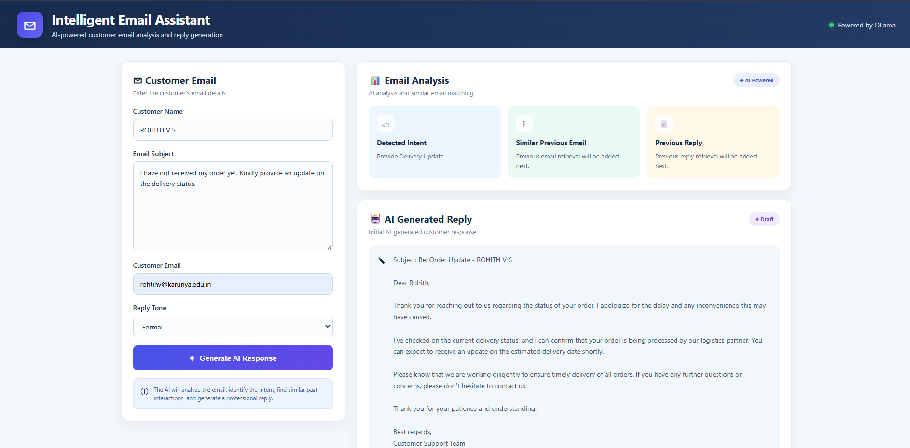
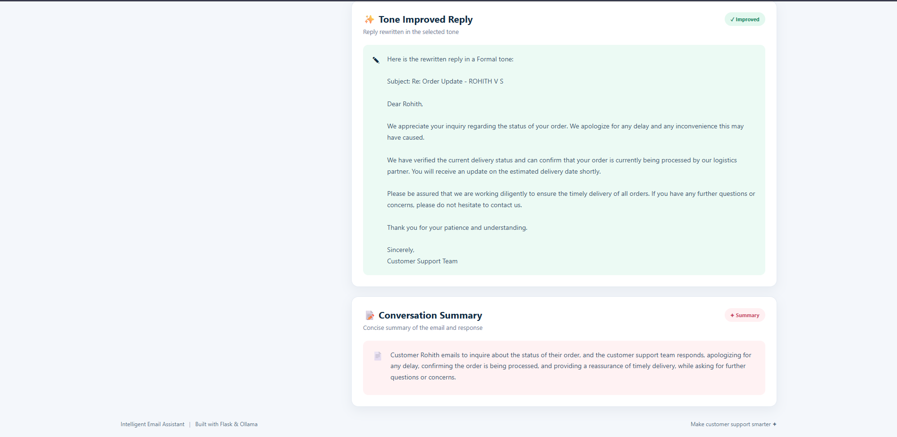

# 📧 Intelligent Email Assistant

An AI-powered customer email assistant built using **Python, Flask, and Ollama (Llama 3.2)**.
The assistant analyzes customer emails and generates context-aware replies based on the customer's issue and selected reply tone.

## 🛠️ Technologies

- Python
- Flask
- Ollama
- Llama 3.2
- HTML5
- CSS3
- JavaScript

## 📁 Project Structure

```text
Intelligent Email Assistant/
├── data/
├── screenshots/
│   ├── UI1.png
│   └── UI2.png
├── static/
│   └── style.css
├── templates/
│   └── index.html
├── app.py
├── requirements.txt
└── README.md
```
📸 Screenshots




